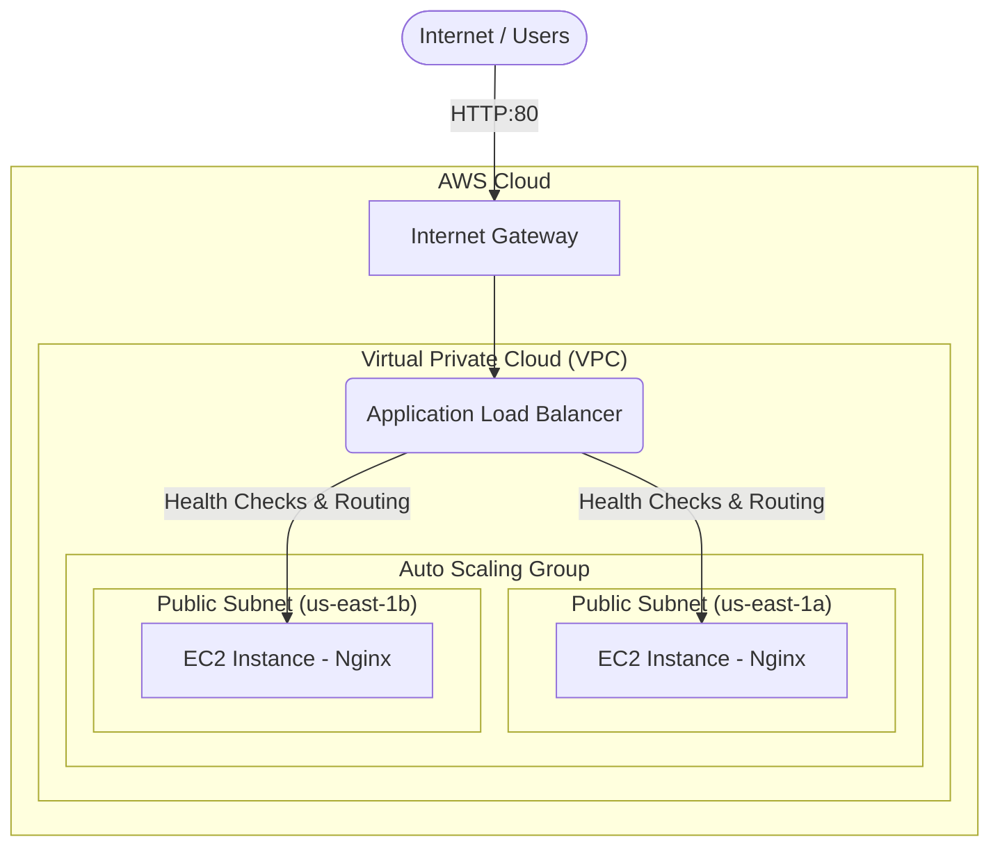
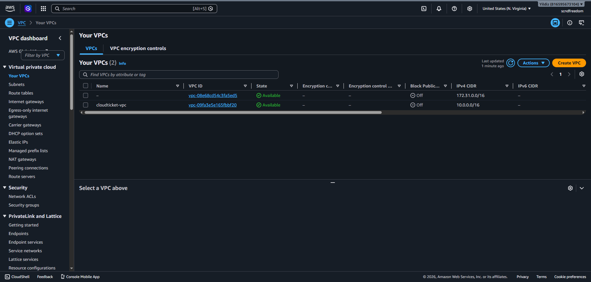
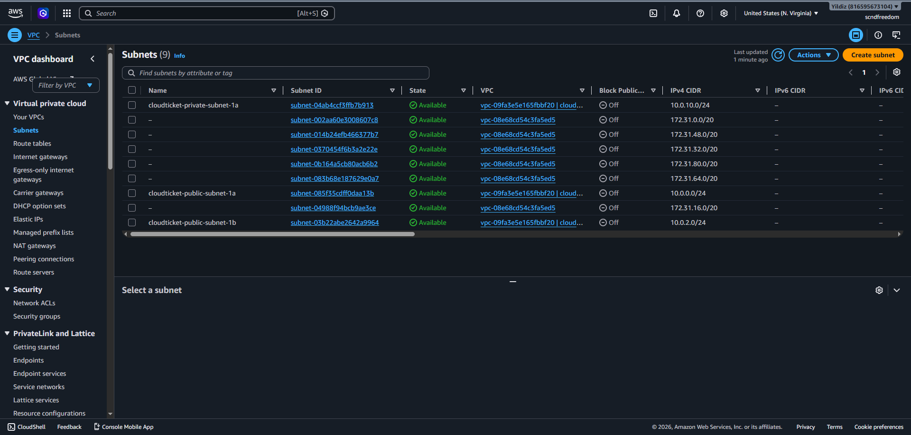
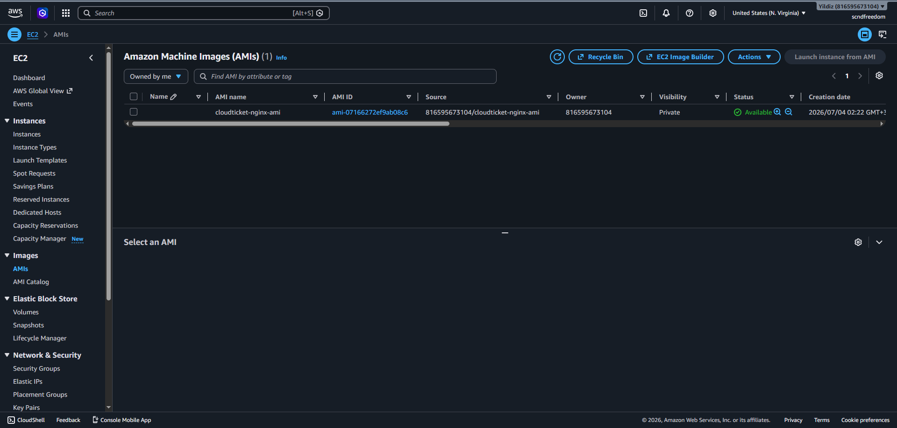

# CloudTicket: Highly Available AWS Web Infrastructure

## About this project
This is my first large scale AWS infrastructure project. Instead of following isolated tutorials, I wanted to build a realistic environment that combines networking, load balancing, Linux administration, and Auto Scaling into a single architecture.

I built this project to learn how highly available AWS infrastructures are designed from the ground up. The scenario simulates an online ticket platform experiencing sudden traffic spikes. The goal was not only to make it work, but also to understand *why* each AWS service was needed and how they connect.




## 📌 Problem Statement

Imagine 300,000 users attempting to access the ticket sales website within a 5 minute window for a popular concert. A traditional single server architecture would immediately crash under the load, resulting in lost revenue and a poor user experience. 

**Challenges of a single server setup:**
- Single Point of Failure (SPOF).
- Inability to handle sudden traffic bursts.
- Wasted infrastructure costs during low traffic periods.

## 🏗️ Architecture Design & Decisions

To solve this, I designed a highly available web infrastructure focusing on elasticity and security. 

**Why Application Load Balancer (ALB)?**
Instead of exposing EC2 instances directly to users, I chose an ALB because it acts as the public entry point for all incoming HTTP traffic. It provides continuous health checks and distributes traffic evenly across multiple Availability Zones, ensuring users never hit a dead server.

**Why Auto Scaling Group (ASG)?**
Ticket sales create unpredictable traffic spikes. I configured Auto Scaling to automatically provision additional EC2 instances when average CPU utilization exceeds 50%, and terminate them during idle periods. This ensures performance during peaks and reduces costs when traffic drops.

**Why Custom AMI?**
Creating an Amazon Machine Image (AMI) ensures that every new EC2 instance launched by the Auto Scaling Group is identical. It boots up already configured with the Nginx web server and my application code, ready to serve traffic immediately.

---

## 📸 Implementation & Proof of Work

### 1. Networking (VPC, Subnets, Security)
I created a custom VPC to isolate the environment. Two public subnets were deployed across different Availability Zones to satisfy the Load Balancer's High Availability requirement. I configured strict Security Groups to allow HTTP traffic via the ALB and SSH access only to my specific IP.

| VPC | Subnets | Route Tables |
|:---:|:---:|:---:|
|  |  |  |

### 2. Compute (EC2, Launch Templates, AMI)
I launched a base Ubuntu EC2 instance, securely accessed it via SSH, and configured an Nginx web server. I then generated a custom AMI from this instance to serve as the golden image for the Auto Scaling Group.

| Running Instances | Launch Template | Custom AMI |
|:---:|:---:|:---:|
|  |  |  |

### 3. Application Load Balancer (ALB)
The ALB routes traffic only to healthy instances registered in the Target Group. The Resource Map below clearly demonstrates the successful routing of HTTP:80 traffic to multiple healthy targets across different Availability Zones.

| ALB List | Resource Map | Target Group Health |
|:---:|:---:|:---:|
|  |  |  |

### 4. Auto Scaling Group (ASG)
The ASG is configured with a minimum capacity of 1, a desired capacity of 2, and a maximum capacity of 4 instances. 

| ASG Capacity | ASG Details |
|:---:|:---:|
|  |  |

---

## 🛠️ Challenges & Troubleshooting

**Challenge 1: Windows SSH Permission Denied**
While attempting to connect to the initial EC2 instance via SSH on a Windows machine, AWS rejected the connection because the `.pem` key file had overly permissive inherited permissions.
* **Solution:** I utilized Windows Command Prompt (`icacls`) to strip inherited permissions, explicitly grant access only to my current user, and remove all other access rights.


**Challenge 2: ALB Health Check Failures**
Initially, instances might fail the Load Balancer health checks if security is misconfigured.
* **Solution:** I ensured that the Security Group attached to the EC2 instances explicitly allowed inbound HTTP (port 80) traffic originating directly from the ALB's Security Group, rather than keeping it open to the entire internet.

---

## 📚 What I Learned

During this project, I gained practical experience in:
- Designing custom VPCs (Subnets, Route Tables, Internet Gateways).
- Building highly available architectures across Multi-AZ environments.
- Configuring Application Load Balancers and Target Groups.
- Creating Launch Templates and custom AMIs.
- Working with Auto Scaling Groups and Dynamic Scaling Policies.
- Managing Linux servers via SSH and troubleshooting permissions.
- Deploying and serving web pages using Nginx.

---

## 📂 Repository Structure

```text
CloudTicket-Architecture/
├── README.md
├── index.html
└── screenshots/
    ├── Auto Scaling/
    ├── Compute/
    ├── Error/
    ├── Extra/
    ├── Load Balancing/
    └── Networking/
```

---

## 🚀 Future Roadmap (Project Status)

✅ **Version 1.0:** Highly Available Web Infrastructure (Current)

**Next Milestones:**
- **Version 2.0:** Add Private Subnets and RDS (Database Layer) to make it a true 3 tier architecture.
- **Version 3.0:** Infrastructure as Code (Migrate manual setup to Terraform).
- **Version 4.0:** Containerization (Dockerize the application).
